# Hi, I'm Danil 👋

**Java & Kotlin Backend Developer** focused on backend architecture, reliable APIs, and database design.

I build applications with Spring Boot and PostgreSQL, and I enjoy working on the engineering behind a product: from business logic and automated tests to CI/CD and deployment. I'm currently working with the **Digital Hustle** team on **prognoCIk**, a cash-flow forecasting platform for small businesses.

**Core stack**

**Also worked with**

## 🚀 Featured project: prognoCIk

[**prognoCIk**](https://github.com/Digital-Hustle/hack-2026-back) is a cash-flow forecasting platform for small businesses, built by the **Digital Hustle** team for the **Center-invest Bank** case at the Autumn 2026 hackathon. It combines bank statements and planned payments to forecast daily balances and highlight potential cash gaps over the next **30 days**.

**Engineering highlights:**

- **Backend architecture:** five Java 21 / Spring Boot services — Auth/Profile, Gateway, PreProcessor, Orchestrator, and Forecast — with explicit API contracts and reproducible calculation snapshots.
- **Financial data:** CSV/Excel imports, validation, categorization, deduplication, recurring payments, and PostgreSQL persistence with Liquibase migrations.
- **Forecasting:** statistical models for daily cash flow, scenario-based uncertainty bands, cash-gap detection, historical backtesting, and “what if” simulations.
- **Business workflows:** payment calendars, employee salaries, plan-vs-actual analytics, Bitrix24 integration, and a read-only AI assistant grounded in application data.
- **Security and delivery:** email-code login, JWT cookies, CSRF protection, company roles, PostgreSQL integration tests, GitHub Actions, and Docker.

**Explore the project:** [Backend / API](https://github.com/Digital-Hustle/hack-2026-back) · [Frontend / Screenshots](https://github.com/Digital-Hustle/prognocik-frontend)

**Also built:** [Certis](https://github.com/DanyaChetvyrtov/certis-web) — a personal finance platform with a [Kotlin / Spring Boot API](https://github.com/DanyaChetvyrtov/certis-api).

## 📊 GitHub statistics
### GitHub Stats

<picture>
  <source media="(prefers-color-scheme: dark)" srcset="./assets/profile-stats/overview.dark.svg" />
  
</picture>

### Top Languages

<picture>
  <source media="(prefers-color-scheme: dark)" srcset="./assets/profile-stats/languages.dark.svg" />
  
</picture>

### Activity Graph

<picture>
  <source media="(prefers-color-scheme: dark)" srcset="./assets/profile-stats/momentum.dark.svg" />
  
</picture>

### GitHub Metrics

<picture>
  <source media="(prefers-color-scheme: dark)" srcset="./assets/profile-stats/composition.dark.svg" />
  
</picture>

## 📬 Get in touch

[LinkedIn](https://www.linkedin.com/in/danil-semenov-5415b0368/) · [Telegram](https://t.me/DanilChetvyrtov) · [LeetCode](https://leetcode.com/u/dabcom2013/) · [Email](mailto:dabcom2013@gmail.com)
